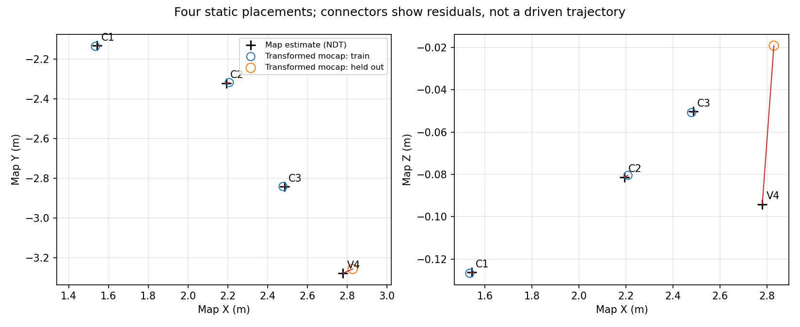
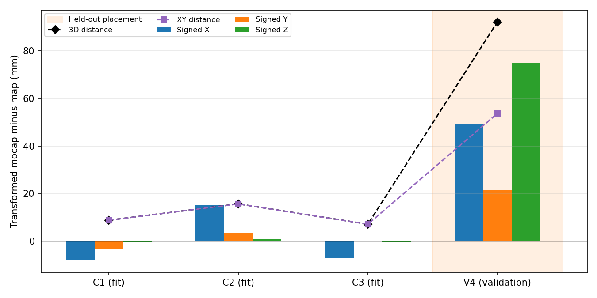

# 固定 map ↔ mocap_world：三点标定与独立一点验证

**四个位置已采集，独立布点协议通过。只用前三点求解；第四点未参与拟合，变换未修改、未广播。**

数据类型：实车测量。

本报告使用同一个 base_link 原点，地图坐标来自 NDT/FAST-LIO，不是独立测量地图真值。

|数据|位置数|三维 RMSE mm|三维最大 mm|XY RMSE mm|XY最大 mm|
|---|---:|---:|---:|---:|---:|
|标定拟合|3|11.159|15.658|11.142|15.635|
|独立验证|1|92.183|92.183|53.691|53.691|

|位置|ΔX mm|ΔY mm|ΔZ mm|三维 mm|XY mm|
|---|---:|---:|---:|---:|---:|
|calib_01|-8.106|-3.400|-0.419|8.800|8.790|
|calib_02|15.228|3.542|0.857|15.658|15.635|
|calib_03|-7.122|-0.143|-0.438|7.137|7.123|
|test_04|49.252|21.378|74.933|92.183|53.691|

误差符号为固定变换后的动捕坐标减地图估计坐标。独立验证只有一个位置，因此其距离 RMSE 与最大值相同；没有把三帧 NDT 当成三次独立实验。

|位置|有效动捕|NDT配对|跨度 s|动捕最大静止半径 mm|地图最大静止半径 mm|
|---|---:|---:|---:|---:|---:|
|calib_01|447|3|4.980|0.265|26.798|
|calib_02|448|3|4.990|0.123|37.633|
|calib_03|443|3|4.980|0.260|19.360|
|test_04|449|3|4.970|0.098|11.915|

静止半径是各自数据散布，不是绝对误差。双方均值使用相同 NDT 时刻的动捕配对；配置窗口为5.0秒，完整原始流与无效信息仍保存。

|采集记录|数据质量|动捕数|NDT配对|说明|
|---|---|---:|---:|---|
|[前序会话/calib_01](../20261017T061341Z_ndt_3calib_1test/calib_01/summary.json)|失败保留|448|2|insufficient_ndt_mocap_pairs; insufficient_ndt_time_coverage|
|[calib_01/summary.json](calib_01/summary.json)|通过|447|3|按预设门槛通过|
|[calib_02/summary.json](calib_02/summary.json)|通过|448|3|按预设门槛通过|
|[calib_03/summary.json](calib_03/summary.json)|通过|443|3|按预设门槛通过|
|[test_04/summary.json](test_04/summary.json)|失败保留|425|2|mocap_invalid_or_unpaired_events_during_window; long_mocap_gap; insufficient_ndt_mocap_pairs; insufficient_ndt_time_coverage; raw_normalized_units_or_coverage_mismatch|
|[validation_retry_02/test_04/summary.json](validation_retry_02/test_04/summary.json)|通过|449|3|按预设门槛通过|

共四个物理位置、6段采集窗口，4段合格；失败段均保留、未用于精度统计。

第4点使用显式指定的补采会话，不按残差自动选择窗口。三点变换未再拟合；共享文件使用相对软链接，避免复制原始数据。补采约定和同位置检查见 validation_retry_02/retry_protocol.json 与 same_placement_check.json。

动捕原点在 map 中 XYZ（m）：[2.486333591514922, -2.7524534595343986, -0.27138499639202396]

地图原点在 mocap_world 中 XYZ（m）：[-3.6687084743626603, 0.39476872348848036, 0.46501653364149104]

冻结标定 SHA256：`939920cefbf169cedb9cd5cb4f9be5d6ff689770c2cba3dc8b7b9a849871c3b7`。验证前后哈希一致，pre_validation_integrity.json 证明冻结时尚无第4点数据。

三维拟合的Z轴倾角约 3.264°；它来自这三个位置的配准，不能当作独立地面倾斜测量。

验证误差明显大于拟合残差，且 Z 分项较大。误差包含 NDT、动捕、安装外参和时间配对影响；单个验证位置不能唯一分离根因。固定偏差可能被三点配准吸收，后续比较方法必须沿用同一变换，不能分别重标定后比较。

数值验收：未预先指定门槛，保持 null，只报告数值。本次没有认证全场、动态同步或独立地图绝对精度。

启动与恢复证据、软件验证状态见会话状态与全工程验证记录。软件检查不代替实车精度检查。

安装外参单独保存于 body_extrinsic.yaml；calibration_id 是会话审计标签，未提供厂家编号则仍为 null。时间使用Ubuntu接收时间，曝光延迟与跨源偏移未独立标定，原始VRPN无厂家光学置信度。没有跨缺口插值、填零、拟合尺度或输出CSV。

[标定YAML](calibration.yaml) · [标定分项报告](calibration_report.md) · [独立验证报告](validation_retry_02/validation_report.md) · [验证JSON](validation_retry_02/validation.json)

本报告只读已有数据与固定变换，不启动或停止节点，不自动驱动车子或修改正式导航TF。
