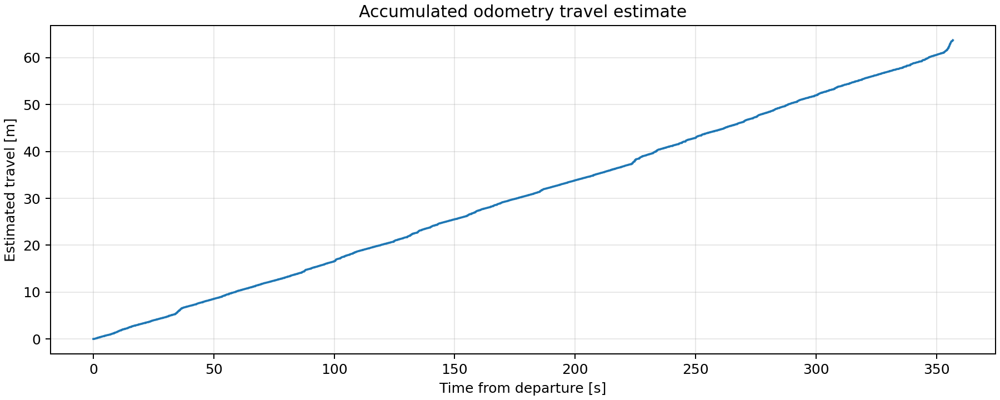
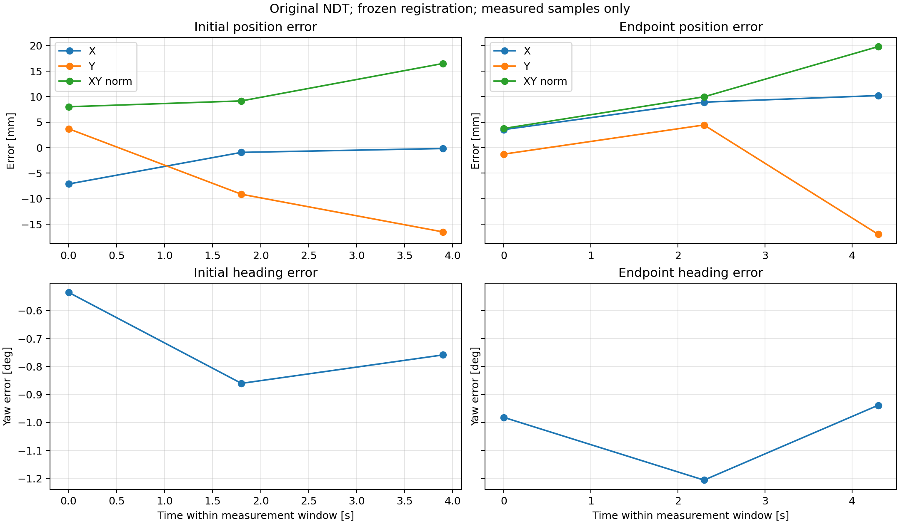

# 原 NDT 全图测试结果

先用三个停车位置建立新固定坐标关系；随后初始与终点评价数据不参与拟合。NDT参与坐标标定，结果是该固定关系下的一致性误差，不认证独立绝对精度。

| 窗口 | 样本 | XY RMSE mm | XY最大 mm | 航向RMSE ° |
|---|---:|---:|---:|---:|
|初始|3|11.847|16.511|0.7306|
|终点|3|12.991|19.815|1.0487|

终点使用同一测量时刻的有效静止动捕历史配对，保留迟到 NDT 输出的实际接收延迟。所有时间戳不变；仍检查真值静止、流有效性、时间配对及同步。不据此声称实时控制新鲜度达标。

累计里程计估计路程：63.739 m。
该距离从连续 odom→base_link 积分，不是起终点直线距离，也不是动捕实测全程里程。

曲线只连接真实配对的NDT测量样本；不补造高频数据。PNG、SVG、PDF与逐样本CSV均已导出。多帧仅为单次停车窗口的描述统计。
