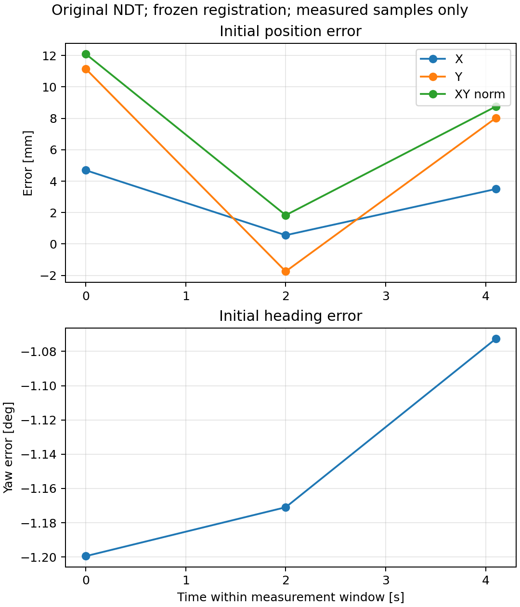

# 原 NDT 全图测试结果

先用三个停车位置建立新固定坐标关系；随后初始与终点评价数据不参与拟合。NDT参与坐标标定，结果是该固定关系下的一致性误差，不认证独立绝对精度。

| 窗口 | 样本 | XY RMSE mm | XY最大 mm | 航向RMSE ° |
|---|---:|---:|---:|---:|
|初始|3|8.686|12.096|1.1490|
|终点|待采集|—|—|—|

初始位置距标定点 calib_03 仅 0.000 m：这是冻结后另采的时间留样，位置不独立于标定点。

曲线只连接真实配对的NDT测量样本；不补造高频数据。PNG、SVG、PDF均已导出。多帧仅为单次停车窗口的描述统计。
