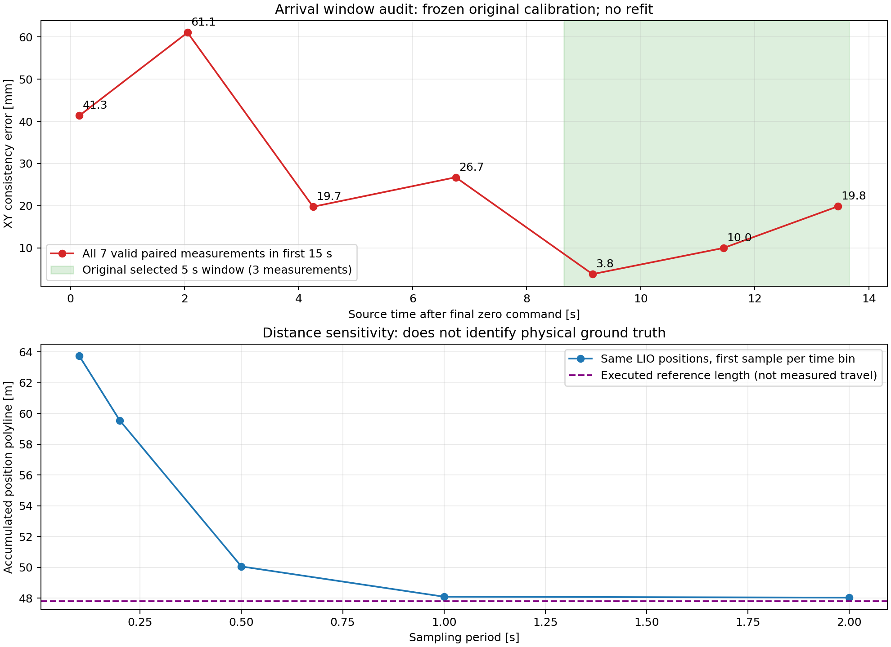

# 原 NDT 数据复核：为什么与之前第四点不同

复核结论：**11.85 / 12.99 mm 的逐帧计算没有单位或 RMSE 算术错误；它们只是本次固定配准下的短时窗口一致性，不能作为 NDT 稳定定位精度。63.74 m 是原始 LIO 位置折线累加，不能当作已测得的实际行驶距离。** 原汇总对这两项限制突出不足，本页补正，原始测量、配准、数值和旧压缩包全部保留。

## 与你指出的三点标定后第四点比较

已定位到之前的 [实测报告](/home/zkam/test_nav/robot_data/experiments/fixed_world_calibration/20261017T061341Z_ndt_3calib_1test_attempt02/report.md)：第四点 XY 为 53.691 mm。

| 同一计算口径 | 之前第四点 | 本次终点短窗 |
|---|---:|---:|
| 实际 NDT 配对数 | 3 | 3 |
| 平均位置之间的 XY 距离（之前报告采用） | 53.691 mm | 8.849 mm |
| 各帧 XY 距离的 RMSE（本次报告采用） | 53.908 mm | 12.991 mm |
| 三点训练 XY 拟合 RMSE | 11.142 mm | 4.094 mm |
| 评价点距最近训练点 | 0.544 m | 0.259 m |

之前逐帧 XY 距离是 56.185、56.453、48.728 mm；这次短窗是 3.762、9.975、19.815 mm。独立使用矩阵乘法和 NumPy 复算，分别恢复 53.908 与 12.991 mm 的逐帧 RMSE。均值距离与逐帧 RMSE 的差别无法单独解释本次差异。

两次使用的旧 PCD、地图配置哈希、`base_link` 参考点、0.18 m 动捕安装外参和 `final_map_to_base_at_cloud` 字段一致。**两次都由 NDT 三点参与配准**，不能只用“这次吸收了固定偏差”解释区别。相机移动后重求了新变换，三点位置、评价位置、NDT 运行状态及评价时间也不同；新终点更靠近训练位置。各项影响无法从这两段 3 帧数据中唯一分离，也不能据此声称算法精度提升。

## 终点窗口对结果影响明显

原选窗源时刻为导航成功后 8.943～13.943 s，只有 3 帧。本次以录包中到站时最后非零指令之后的首条零指令为基准，另外固定检查到站后 0～15、0～30、0～60 s，所有区间在计算误差前声明；不重拟合、不按误差选择区间。

| 固定到站区间 | 配对数 | 逐帧 XY RMSE | 质量状态 |
|---|---:|---:|---|
|arrival_0_15s|7|31.735 mm|诊断，NDT 间隔超限|
|arrival_0_30s|15|23.094 mm|诊断，NDT 间隔超限|
|arrival_0_60s|30|18.854 mm|诊断，NDT 间隔超限|

前 15 秒 7 帧包含 41.350、61.067 mm 的较大误差，随后有较小误差；只突出后面的 3 帧会掩盖到站阶段的变化。

这些扩展区间动捕静止、单位、同源时间配对检查通过，原始/米制覆盖率为 100%；但 NDT 最大间隔 2.500571490 s，比冻结门槛 2.5 s 超出 0.571490 ms。因此仍标记为质量未通过、仅作诊断，未事后放宽门槛，也不以 31.735 mm 替换原正式短窗。原首个候选因至少 3 帧要求及间隔门槛失败后选择下一个质量通过窗口，虽未按误差筛选，确实得到了较晚的到站窗口。

原正式初始窗口末帧距出发约 199 s；另外按出发前 10 s（排除第一条非零指令）固定复核，5 帧 XY RMSE 为 9.349 mm，质量通过。这个补充窗口不替代原初始记录，同样不能认证独立绝对精度。

## 路程的重新解释

| 同一 LIO 轨迹的取点间隔 | 原始位置折线长度 |
|---|---:|
|0.1 s|63.739 m|
|0.2 s|59.543 m|
|0.5 s|50.056 m|
|1.0 s|48.090 m|
|2.0 s|48.029 m|

原始位置高频变化显著抬高了累加值。降低取点频率也会丢掉细节及弯道长度，所以 **48.090 m 也不是独立测得的真实路程**，不能挑这个数替换 63.739 m。明确已知的是下发参考路线长度 47.800 m；本轮实际物理总路程没有独立真值。`/odom` 速度还存在大尖峰，其积分也不作为替代真值；底盘指令积分只表示命令，不能当成测量。

后续对比需要固定到站后的采样延时、窗口长度、时间及质量规则，保留全部试次；不能各组分别用被测定位结果重新拟合后，就据残差宣布精度提升。若要评价独立绝对精度，仍需独立地图控制点。当前数据能够保留实车运行、整圈地图估计跟踪误差，以及明确窗口和配准条件下的定位一致性结果。

[逐项复核 JSON](review_summary.json) · [固定到站窗口逐样本数据](stationary_window_audit.json) · [出发前补充窗口](predeparture_window_audit.json) · [路程敏感性](distance_audit.json)

本复核仅离线读正式录包与旧数据，未启动小车、修改雷达或定位参数，未改配准和原始 CSV。补充诊断不能冒充新增实车试次或通过质量门槛的正式成绩。

[之前第四点配对与变换的来源清单](previous_reference/source_manifest.json)；同目录保留两份原文件副本供复算。
