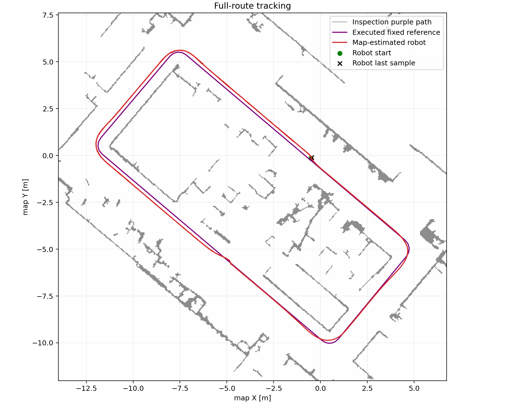
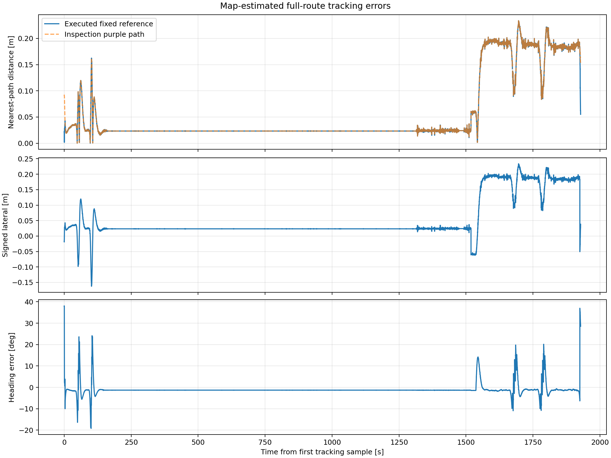
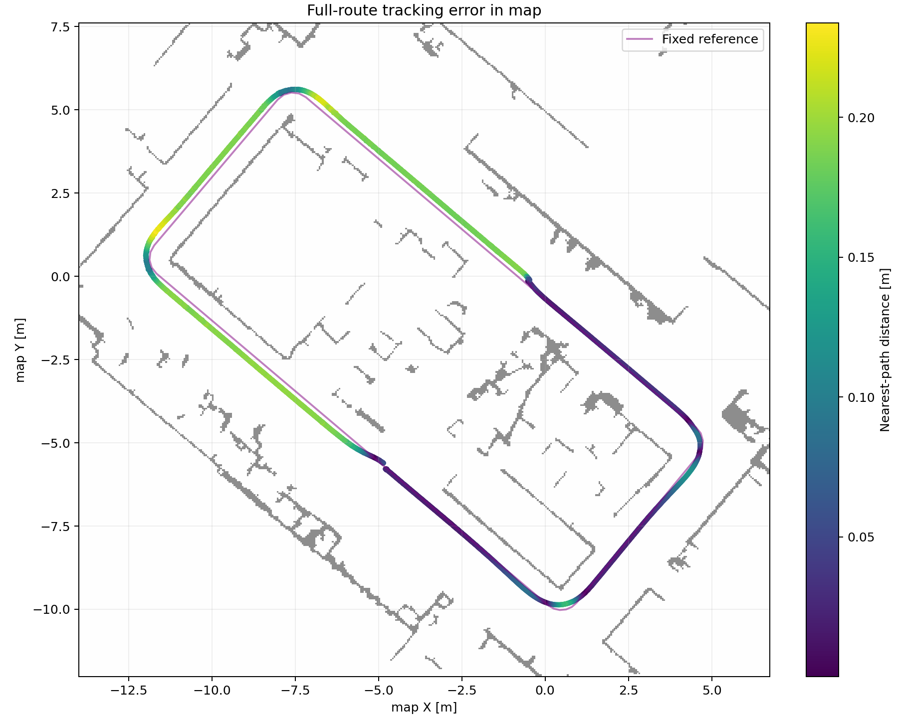

# 整圈地图轨迹跟踪误差

使用原 map 中小车 base_link 估计轨迹与实际下发的固定 FollowPath 比较；不拟合或平移轨迹。该项是跟踪偏差，动捕定位误差见同轮初始/终点报告。

参考路径长 46.196 m；19266 个实际样本；窗口 1927.84 s。
到路径距离 RMSE 0.0854 m，P95 0.1923 m，最大 0.2338 m。
航向误差 RMSE 3.104°。

紫线偏差另保留；完整 FollowPath 含接入路径。时间戳为巡检节点采样时刻，未保存对应 TF 源时刻，不用于动态动捕同步。
地图轨迹折线长度含定位修正跳变，实际行驶距离以终点报告的连续 LIO odom 积分为准。
大于 0.5 秒的采样缺口：99；图中不跨缺口连线。

图形均导出 PNG/SVG/PDF；本次禁用 CSV 导出。
