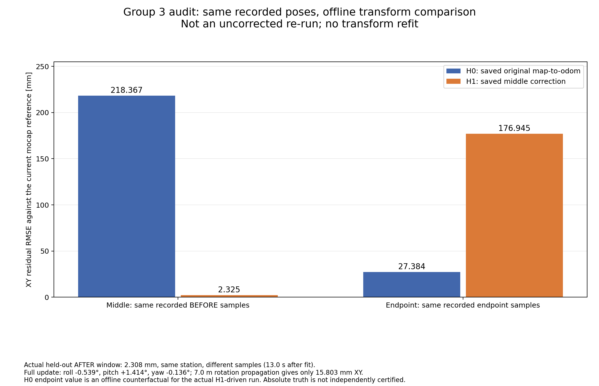

**三组数据审计结论（2026-10-19）：目前不能据此给三种方案排优劣。**

多数静止残差可以用原矩阵与原配对样本复算，问题集中在评价参考、全局纠偏假设、不同测试条件及统计口径。原始试次和结果包保留；本目录另存审计证据。

| 记录 | 初始 XY RMSE | 中途 | 终点 XY RMSE | 可解释范围 |
|---|---:|---|---:|---|
| 第1组原 NDT | 11.85 mm | 未评价 | 12.99 mm | NDT 参与配准；初终点各仅3帧，不能认证稳定绝对精度 |
| 第2组正式 trial_02 | 5.65 mm | 缺测 | 13.36 mm | 当前固定动捕关系下的静止残差；不是全图真值 |
| 第2组0.55 m测试版 | 4.46 mm | 99.52 mm，运动中 | 14.39 mm，参考异常 | 终点刚体姿态近180°翻转，该终点成绩不可作为有效定位精度 |
| 第2组0.60 m测试版2 | 4.08 mm | 181.98 mm，静止 | 10.44 mm | 初始化与同点评价；全圈原生LIO记录有大缺口 |
| 第3组0.60 m | 7.86 mm | 218.37 → 2.31 mm，静止 | 176.95 mm | 中途一次全局变换更新；长暂停、低速及较大延迟阈值使条件变化 |

**第3组终点变差的直接机制已经量化。**

对每一对原始静止样本，保持原生LIO位姿和动捕位姿不变，仅分别使用已保存的纠偏前变换 H0、纠偏后变换 H1：

`e_k = translation(Hk × T_F_B) − translation(T_map_mocap × T_M_B)`。

| 同一批保存的样本 | H0下 XY RMSE | H1下 XY RMSE |
|---|---:|---:|
| 中途纠偏前31对 | 218.367 mm | 2.325 mm |
| 中途后续32对 | 218.970 mm | 2.308 mm |
| 终点31对 | **27.384 mm** | **176.945 mm** |

这说明：本轮中途把局部约218 mm的偏差作为持久全局刚体补偿应用；终点原有残差已经很小，同一补偿却将终点估计的平面坐标移动约204 mm，形成过补偿。27.384 mm是同一批实际终点样本的离线换算，不能当作真正无纠偏重跑的成绩，因为后半程实际导航使用了 H1。

H1相对H0总旋转约1.519°，主要是roll −0.539°、pitch +1.414°，yaw仅 −0.136°。以中途点为枢轴，约7 m外终点的旋转附加项在XY只有15.8 mm，主要影响Z。因此不能用“1.5°乘7 m”解释本次177 mm的平面误差；主要XY影响来自持久平移补偿。仅去掉roll/pitch也不会自动解决平面失配。

纠偏后2.308 mm来自另一批时间样本，与拟合样本无重合，但两窗动捕平均位置只相差约0.061 mm。这证明同一站位的短时一致性，不能证明空间独立或整图精度。

原中途218 mm究竟来自LIO局部误差、地图与动捕空间配准、刚体参考点或姿态外参，现有数据不能唯一分解。当前能够确定的是：它不适合作为本轮所有位置都成立的持久刚体偏差。

**第2组中途大、终点小，不等于证实沿程漂移消失。**

0.60 m版本的中途距初始化锚点约7.155 m，终点仅距锚点约0.096 m。初始到中途的位置基线在LIO和动捕间方向相差约1.283°、长度相差约81.8 mm。这是两个站点的诊断差异，不是已求得的可靠标定参数。原地转向诊断的残差为11.01 → 70.13 → 8.75 mm，存在朝向相关变化的迹象，但车辆参考点也有移动，不能单凭它断定某个外参错误。

实际FAST-LIO代码包含点云与内部地图的近邻匹配和迭代滤波更新；它不是只积分速度的航位推算。误差范数没有必须单调增加的约束，回到旧场景和初始锚点时残差变小本身不证明代码暗中进行了动捕纠偏。

**第1组的小数值对窗口敏感。**

12.99 mm对应到站后约8.94～13.94秒的3帧。固定到站前15秒诊断窗7帧得到31.74 mm；前30秒23.09 mm，前60秒18.85 mm。诊断窗有既定间隔质量限制，不能作为替换成绩，但足以说明不能只拿3帧概括稳定精度。三点坐标配准使用了NDT位置，评价不是独立地图控制点认证。

**轨迹跟踪与路程存在额外统计限制。**

- 第3组连续11,540条map位置与朝向完全相同，持续1153.99秒。采集器使用最新缓存TF并写程序当前时间，没有保存对应TF源时间；这些重复记录不能当作新的独立定位观测。
- 第3组长停车区间占约71.7%的跟踪样本。全样本跟踪RMSE为85.43 mm，剔除明确停车区间后为155.93 mm；两项都属于地图估计位姿对参考线的偏差，不是真实小车全程动捕跟踪精度。
- 第1组同一LIO轨迹原始累计63.74 m，1秒取点48.09 m；第3组已观测原始累计79.19 m，1秒取点49.84 m。两组都对高频抖动敏感。剔除第3组长停车后的61.52 m仍是原始LIO估计，不能认定为独立实测物理路程。
- 第2组0.60 m版原生数据约30.35～263.05秒缺录，无法恢复完整原生LIO里程；地图实际轨迹仍完整，也不能用它冒充原生里程。
- 第1组用旧地图，后两组用新地图；路径长度、起终点、外扩距离、停留时间和后半程速度不完全相同。第3组还把位姿年龄容忍放宽至3秒，以最高0.10 m/s继续。不能把全部差别归因于算法。
- 部分汇总中的`valid_for_localization_accuracy=true`只来自未检测到近倒置姿态，并没有验收独立绝对精度。该字段容易造成过强解读；本审计明确将独立全图绝对精度认证标为未完成。

**下一步应先验收测量链与纠偏模型，再进行正式整圈对比。**

先在两处动捕区用多个位置、多个车头方向检查同一套坐标关系，至少留出未参与求变换的位置作验收；复核刚体重识别后的原点与轴定义是否仍对应既有安装外参。明确纠偏要更改的状态以及离开覆盖区后的作用范围，不把单点残差直接当作全局恒定偏差。随后统一物理路线、控制参数、停车窗口和采样完整性规则，做多次重复，每次分别统计。

可复算证据：[第3组矩阵审计](audit_summary.json)、[跨组统计与缓存位姿检查](cross_group_findings.json)、[复算脚本](recompute_group3_transform_audit.py)。第1组窗口和路程依据原试次的`review_01/review_report.md`；第2组各版本依据对应`data/results_summary.json`及静止配对记录。本审计没有重拟合原始结果，没有启动机器人。
