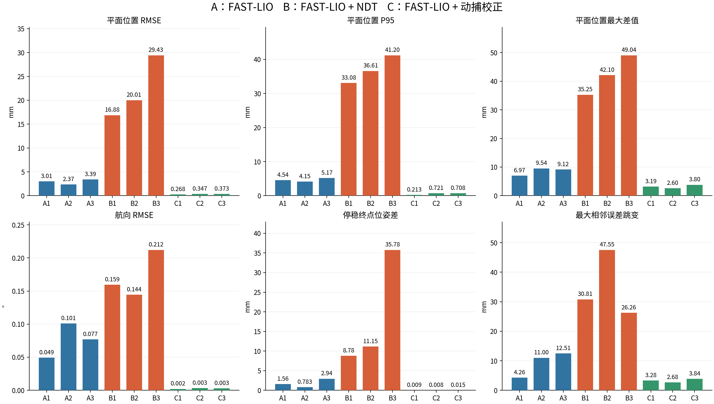
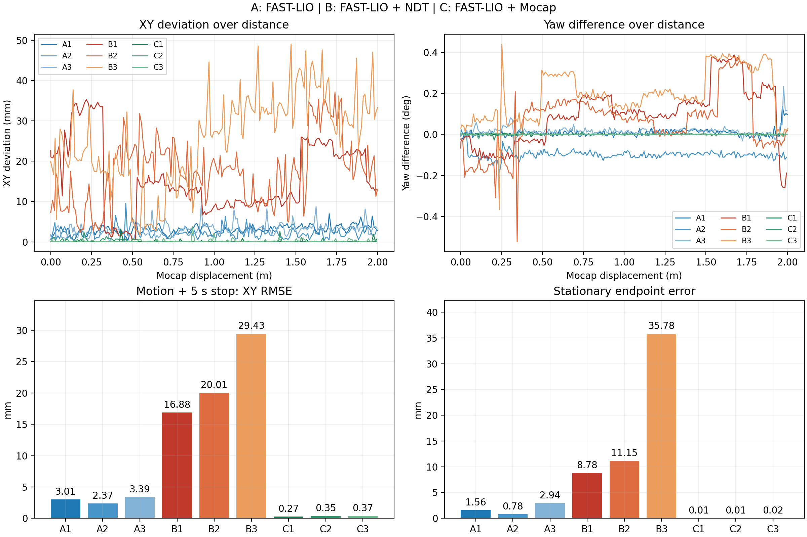

# A/B/C 各三次两米试验对比

A=FAST-LIO，B=FAST-LIO+固定地图 NDT；A/B 动捕仅用于距离触发与离线参考。
47.15° 安装角固定，单次只用起始静止窗口做一次 SE(2) 对齐，不拟合尺度或测试轨迹。

| 试次 | 方向 | XY RMSE mm | P95 mm | Max mm | yaw RMSE ° | 终点差 mm |
|---|---|---:|---:|---:|---:|---:|
| A1 | forward | 3.014 | 4.541 | 6.968 | 0.0491 | 1.562 |
| A2 | reverse | 2.369 | 4.152 | 9.537 | 0.1010 | 0.783 |
| A3 | forward | 3.387 | 5.174 | 9.124 | 0.0768 | 2.943 |
| B1 | forward | 16.879 | 33.085 | 35.252 | 0.1594 | 8.779 |
| B2 | reverse | 20.012 | 36.611 | 42.104 | 0.1445 | 11.146 |
| B3 | forward | 29.425 | 41.196 | 49.038 | 0.2121 | 35.778 |
| C1 | reverse | 0.268 | 0.213 | 3.194 | 0.0020 | 0.009 |
| C2 | forward | 0.347 | 0.721 | 2.596 | 0.0033 | 0.008 |
| C3 | reverse | 0.373 | 0.708 | 3.804 | 0.0029 | 0.015 |

A：三次 RMSE 均值 2.923 mm，样本标准差 0.515 mm。

B：三次 RMSE 均值 22.105 mm，样本标准差 6.530 mm。

C：三次 RMSE 均值 0.329 mm，样本标准差 0.055 mm。

当前短路线样本中，B 的相对误差大于 A，不能推广为所有环境下 NDT 都更差。
各组均有正反向，只有三个试次；不能将所有帧混合冒充独立重复或宣称统计显著性。
动捕使用 Ubuntu 接收时间，时间偏移尚未独立核实；动态结果不是已认证绝对精度。
A/B 之间底盘和 FAST-LIO 曾重启，实际起点、朝向也不完全相同；不是严格同一轨迹的配对试验。
B 第二次曾在发车前被阻止，未发生运动；现场重新确认后在新目录继续，原阻止记录保留。
原始 bag 和单次逐帧数据保留在 comparison.csv 的 directory 所指目录。

C=FAST-LIO+动捕全局校正，参考参与校正，数值为同源动捕一致性，不是独立绝对定位精度。
A/B 顺序为前/倒/前；C 为倒/前/倒，不能作为三个配对同向重复或据此给出绝对精度提升倍数。
C 批次前因旧 FAST-LIO 滞后，按原参数重启；批内三趟未重启。
终点位姿差不是相对 2.000 m 的停车过冲；最大相邻误差跳变已扣除真实运动。

