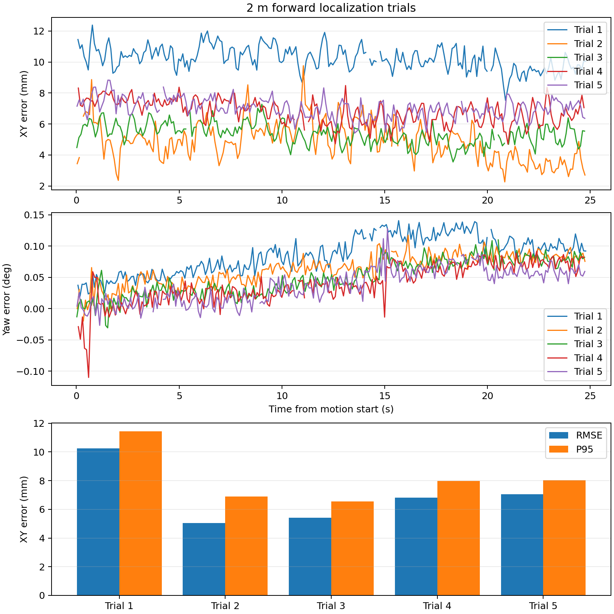
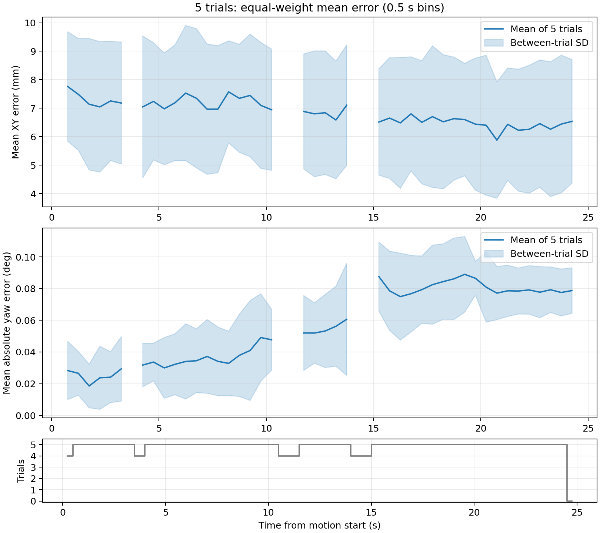

# 前进 2 米定位实验汇总

已完成 5/5 组；自动运动进程已退出，后续复位由人工完成。

|组|平均 XY 误差 (mm)|XY RMSE (mm)|P95 (mm)|最大 (mm)|航向 RMSE (°)|参考配对覆盖率|停车位移 (m)|
|---|---:|---:|---:|---:|---:|---:|---:|
|1|10.23|10.26|11.45|12.38|0.091|98.79%|2.0094|
|2|4.90|5.05|6.89|9.76|0.067|98.79%|2.0093|
|3|5.37|5.41|6.56|7.28|0.056|98.39%|2.0081|
|4|6.78|6.82|7.97|8.48|0.050|99.19%|2.0081|
|5|7.03|7.06|8.02|8.83|0.047|97.98%|2.0070|

各轮 XY RMSE 的等权均值 ± 样本标准差：6.92 ± 2.06 mm；仅为这批记录的描述统计，不将每帧作为独立实验。

各轮平均 XY 距离误差的等权平均：6.86 mm。平均距离误差与 RMSE 分开报告，不将 X/Y 正负误差抵消后当作距离误差。

平均曲线：按运动开始计时，以0.5秒固定分箱计算每轮箱内平均，再按轮等权平均。每轮每箱至少3个有效配对且含箱边界的最大间隔≤0.2秒；只有全部完成轮均有有效数据时才画均值，缺失不插值、不填零。阴影为轮间样本标准差，不是置信区间；下方记录实际支持轮数。全程统计仍使用完整预定义窗口，不因分箱筛选而改变。

统计从运动开始至发零后5秒，前置静止和退出清理阶段另存。最近时间配对≤25ms，无插值、填零或事后轨迹拟合；参考配对覆盖率是有效配对的原生定位帧比例，并非光学曝光覆盖率。

两边均已换算至 base_link，使用同一冻结 map↔mocap 标定；不使用 NDT。这是动捕初始锚定后 LIO 的定位误差，不是对地图原点或刚体外参精度的独立验证。动捕曝光延迟与传感器时差未经独立核实，因此动态精度是本次配置下的初步测量。

第2轮前静止重启局部 LIO，并关闭累计整图显示发布；第2轮起沿用同一初始化，后续以各轮 manifest 为准。第1轮初始化不同。人工复位也有位置、朝向差异，下表直接报告，不能宣称完全相同路线的严格重复性或据此认定算法改善。

|组|距第1轮起点 (cm)|相对第1轮航向 (°)|位移/运动时间 (m/s)|请求速度 (m/s)|
|---|---:|---:|---:|---:|
|1|0.00|0.00|0.101|0.15|
|2|8.34|-5.68|0.101|0.15|
|3|12.75|-1.06|0.101|0.15|
|4|15.30|-2.27|0.101|0.15|
|5|16.39|-3.96|0.101|0.15|

位移/运动时间为平均前进速度，不是恒速保证；停车距离包含惯性过冲。

共保存 8 次前进尝试，其中 5 次完成，完成率 62.5%；包括静止阶段启动失败，不含自动返回段。失败未删除、不计入完成轮的误差均值。

|尝试目录|结果|原因|停止触发位移 (m)|
|---|---|---|---:|
|[20261017T092725Z_forward_2m_01](20261017T092725Z_forward_2m_01/report.md)|aborted|mocap_stale|0.2012228057438651|
|[20261017T093717Z_forward_2m_02](20261017T093717Z_forward_2m_02/report.md)|completed|target_reached|2.0005859229910943|
|[20261017T095718Z_forward_2m_round02](20261017T095718Z_forward_2m_round02/report.md)|aborted|localization_pose_stale|0.0|
|[20261017T095917Z_forward_2m_round02_retry](20261017T095917Z_forward_2m_round02_retry/report.md)|completed|target_reached|2.000830549081907|
|[20261017T100326Z_forward_2m_round03](20261017T100326Z_forward_2m_round03/report.md)|completed|target_reached|2.0003861358576738|
|[20261017T101338Z_forward_2m_round04](20261017T101338Z_forward_2m_round04/report.md)|aborted|Preflight blocked: ['operator_mode_not_EXTERNAL:MANUAL']|未知|
|[20261017T101420Z_forward_2m_round04_retry](20261017T101420Z_forward_2m_round04_retry/report.md)|completed|target_reached|2.0004765964556355|
|[20261017T101743Z_forward_2m_round05](20261017T101743Z_forward_2m_round05/report.md)|completed|target_reached|2.0003092647712846|

此前3次自动返回失败记录同样保留，但不作为前进试验。原监督程序退出检查标记false均保持原样；第2轮独立复核481条零命令，第4轮872条，第5轮605条，均无自动速度发布者。见各轮 post_stop_verification.json；正式结束时guard状态及进程退出码见manifest.json。

每轮目录包含 bag/、raw.jsonl、errors_xy.png、results.json、report.md、manifest.json 和冻结输入。CSV已按用户要求删除，新轮禁用CSV导出；曲线从原始消息在内存中重算，汇总数值保存于forward_summary.json。

- 第1组：[报告](20261017T093717Z_forward_2m_02/report.md)、[误差图](20261017T093717Z_forward_2m_02/errors_xy.png)
- 第2组：[报告](20261017T095917Z_forward_2m_round02_retry/report.md)、[误差图](20261017T095917Z_forward_2m_round02_retry/errors_xy.png)
- 第3组：[报告](20261017T100326Z_forward_2m_round03/report.md)、[误差图](20261017T100326Z_forward_2m_round03/errors_xy.png)
- 第4组：[报告](20261017T101420Z_forward_2m_round04_retry/report.md)、[误差图](20261017T101420Z_forward_2m_round04_retry/errors_xy.png)
- 第5组：[报告](20261017T101743Z_forward_2m_round05/report.md)、[误差图](20261017T101743Z_forward_2m_round05/errors_xy.png)
