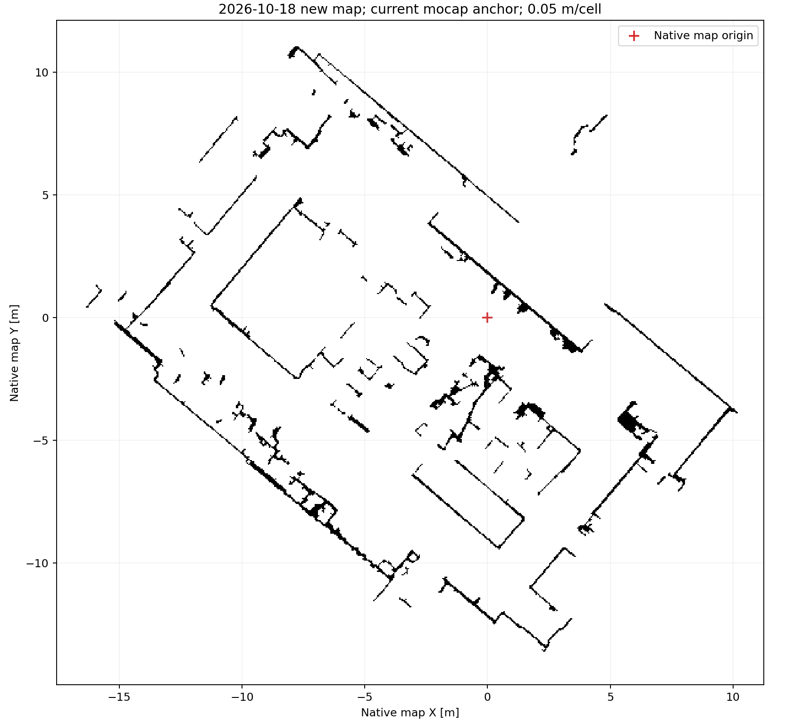

# 当前布局动捕初始建图：已保存归档

本次人工走图已完成，原生 PCD 保存成功，二维地图生成并检查通过。建图和录包已结束，底盘、雷达、动捕接收保留。第 2、3 组定位与导航试验尚未启动。

| 产物 | 信息 |
|---|---|
| [原生 PCD](raw/native_F.pcd) | 3,188,533 点，102,033,309 bytes |
| [二维地图配置](grid/map.yaml) | 0.05 m/格，576×541 |
| [二维栅格](grid/map.pgm) | 原有切片、滤波及投影流程 |
| [MOCAP↔map 标定](calibration.yaml) | 当前相机布局，32 对、3.100 秒静止同步数据 |
| [保存与检查汇总](real_save_summary.json) | 点数、边界、标定、投影及完整性结果 |
| 原始录包 | mapping_bag/，已正常关闭，503226 条消息 |

地图原点在当前动捕世界中的 XYZ 为 **(-0.031343, 4.998318, 0.393602) m**，完整旋转和平移双向矩阵在标定文件中。刚体、车体、IMU 和雷达安装外参与昨天相同。

PCD 保留首次 FAST-LIO 原生地图坐标（map=F0），未将点云变换到动捕世界；固定 MOCAP↔map 关系另存，和昨天的代码方式一致。初始化后由 LIO 连续建图，不使用 NDT 或持续动捕纠错。静止拟合残差不是独立定位精度。

PCD SHA256：`d9c64f4b9b001c6cf7a10785626c9265308970e11060099d4ec9ded2f32c0b0c`。标定 SHA256：`f2dedfadfe2c3a2066ec4f32c5fc05b2b098cab655efe70a6107ec4715b75608`。投影前后 PCD 哈希一致；旧 NDT PCD 和昨天的原生 PCD 均已核验未改变。原始录包 SQLite 完整性检查通过。

[文件哈希清单](archive_manifest.json) · [初始化原始数据](initialization/raw.jsonl) · [后续加载命令](COMMANDS.md)
