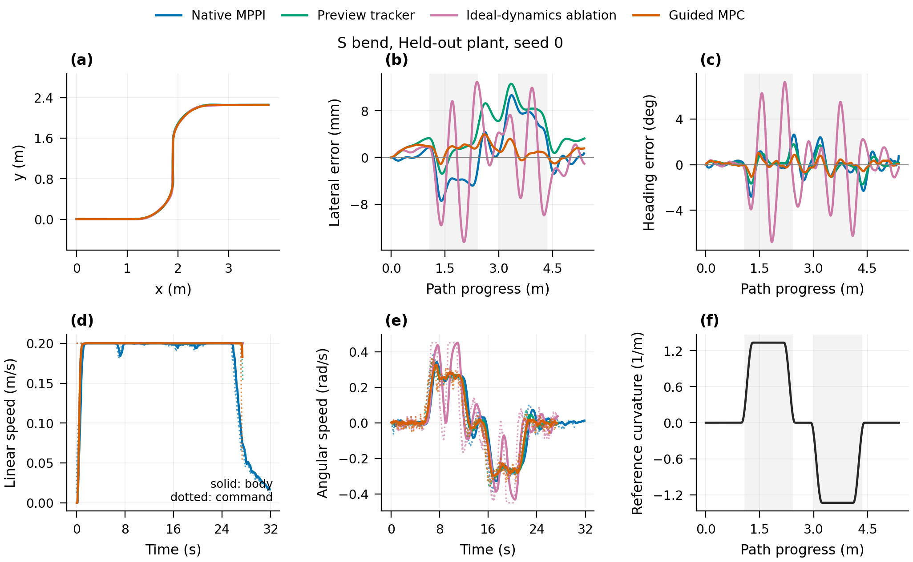
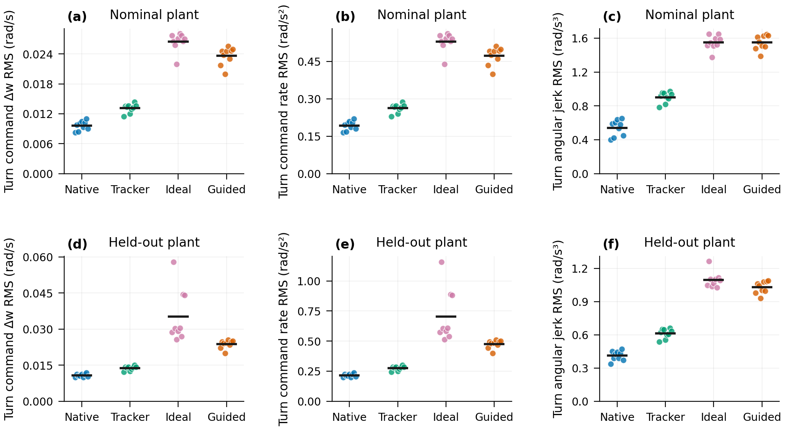
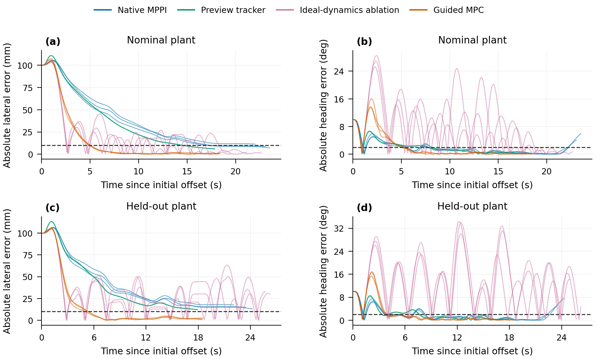
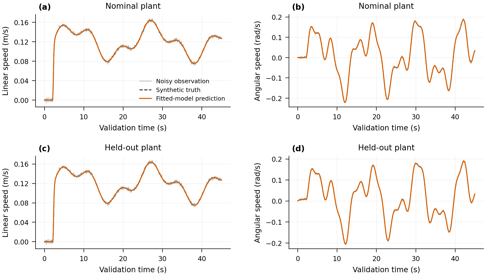

# Results and discussion

## Evidence and experiment inventory

The main experiment comprises 72 synthetic closed-loop trials, with 24 additional initial-error recovery trials and two historical-route simulations. All 98 closed-loop routes reached their geometric completion criterion. The dataset also contains independent-input open-loop model experiments and noisy-output identification examples. None of these experiments executes FAST-LIO/NDT or measures physical vehicle accuracy. The historical FAST-LIO/NDT record is contextual evidence only and is not merged with synthetic errors.

## Tracking accuracy and ablation

Main tracking experiment. Values are mean ± sample SD of per-trial statistics across three fixed routes and three reused seeds (9 conditional observations per controller/condition), not confidence intervals or 9 independent route draws. All 72 routes completed.

|Condition|Controller|Turn RMSE [mm]|Turn P95 [mm]|Yaw RMSE [deg]|Turn speed [m/s]|Turn compute P95 [ms]|
|---|---|---|---|---|---|---|
|nominal|Native MPPI|4.182 ± 2.100|6.019 ± 2.710|0.545 ± 0.062|0.199 ± 0.001|8.92 ± 0.86|
|nominal|Preview tracker|0.401 ± 0.122|0.688 ± 0.168|0.104 ± 0.018|0.200 ± 0.000|1.22 ± 0.10|
|nominal|Ideal-dynamics ablation|2.442 ± 0.316|4.943 ± 0.338|1.585 ± 0.333|0.200 ± 0.000|26.75 ± 3.49|
|nominal|Guided MPC|0.893 ± 0.127|1.594 ± 0.212|0.321 ± 0.041|0.200 ± 0.000|25.04 ± 3.27|
|heldout|Native MPPI|5.731 ± 1.211|8.342 ± 1.531|1.004 ± 0.073|0.198 ± 0.001|8.91 ± 0.88|
|heldout|Preview tracker|5.074 ± 2.312|8.154 ± 3.883|0.714 ± 0.045|0.200 ± 0.000|1.34 ± 0.17|
|heldout|Ideal-dynamics ablation|8.613 ± 1.641|15.341 ± 3.348|4.376 ± 0.650|0.199 ± 0.001|26.46 ± 3.65|
|heldout|Guided MPC|1.461 ± 0.125|2.516 ± 0.418|0.390 ± 0.071|0.200 ± 0.000|24.06 ± 1.95|

Guided MPC reduced mean turn lateral RMSE from 4.182 to 0.893 mm in the nominal condition (78.7% reduction), and from 5.731 to 1.461 mm under the stated model mismatch (74.5% reduction). These are ratios of conditional mean per-trial errors, not population effect estimates. The true synthetic state is used for evaluation; the controller receives the perturbed state.

The preview tracker achieved the smallest nominal error (0.401 mm), outperforming guided MPC in that setting. Under the held-out mismatch, its error increased to 5.074 mm, compared with 1.461 mm for guided MPC. The ideal-dynamics ablation reached 8.613 mm. This pattern supports the utility of execution-chain prediction and residual feedback in these cases, while showing that sampling is not uniformly beneficial. The ideal ablation jointly removes prediction dynamics and their associated compensation, so it does not isolate every mechanism individually.

Mean turn speeds are close, but their time profiles are not forced to coincide. The results therefore do not establish an isolated yaw-controller advantage under a pointwise identical speed reference. All individual trials and phase-specific results remain available for that distinction.

*Representative seed 0 was fixed before result selection. The complete figure caption, data sources and all remaining geometry/condition combinations are retained in the figure index.*

Phase-resolved tracking errors. Phases are fixed by reference curvature and its arc-length derivative; the nine-observation variability is descriptive.

|Condition|Controller|Geometry phase|Lateral RMSE [mm]|Lateral P95 [mm]|Yaw RMSE [deg]|
|---|---|---|---|---|---|
|nominal|Native MPPI|line|2.685 ± 0.859|4.289 ± 1.437|0.416 ± 0.108|
|nominal|Native MPPI|entry|2.612 ± 0.856|3.972 ± 1.392|0.943 ± 0.104|
|nominal|Native MPPI|apex|4.251 ± 2.259|5.782 ± 2.782|0.384 ± 0.070|
|nominal|Native MPPI|exit|4.855 ± 2.793|5.857 ± 3.137|0.550 ± 0.081|
|nominal|Preview tracker|line|0.220 ± 0.091|0.446 ± 0.184|0.061 ± 0.011|
|nominal|Preview tracker|entry|0.305 ± 0.119|0.508 ± 0.198|0.137 ± 0.043|
|nominal|Preview tracker|apex|0.430 ± 0.137|0.686 ± 0.164|0.078 ± 0.012|
|nominal|Preview tracker|exit|0.331 ± 0.147|0.536 ± 0.253|0.143 ± 0.039|
|nominal|Ideal-dynamics ablation|line|2.598 ± 0.450|7.158 ± 0.578|0.962 ± 0.239|
|nominal|Ideal-dynamics ablation|entry|2.413 ± 0.194|4.470 ± 0.311|1.373 ± 0.191|
|nominal|Ideal-dynamics ablation|apex|2.525 ± 0.408|5.085 ± 0.403|1.544 ± 0.390|
|nominal|Ideal-dynamics ablation|exit|2.009 ± 0.585|3.956 ± 0.899|1.889 ± 0.344|
|nominal|Guided MPC|line|0.687 ± 0.195|1.450 ± 0.411|0.170 ± 0.023|
|nominal|Guided MPC|entry|1.143 ± 0.208|1.664 ± 0.254|0.454 ± 0.112|
|nominal|Guided MPC|apex|0.865 ± 0.161|1.499 ± 0.232|0.212 ± 0.030|
|nominal|Guided MPC|exit|0.640 ± 0.144|1.134 ± 0.247|0.479 ± 0.078|
|heldout|Native MPPI|line|1.512 ± 0.355|2.854 ± 0.662|0.632 ± 0.117|
|heldout|Native MPPI|entry|2.473 ± 0.571|4.731 ± 1.334|1.711 ± 0.118|
|heldout|Native MPPI|apex|6.395 ± 1.286|8.507 ± 1.617|0.739 ± 0.053|
|heldout|Native MPPI|exit|5.081 ± 1.801|6.055 ± 2.182|0.960 ± 0.160|
|heldout|Preview tracker|line|3.756 ± 1.306|6.738 ± 2.694|0.476 ± 0.066|
|heldout|Preview tracker|entry|4.471 ± 1.655|6.784 ± 2.983|1.096 ± 0.076|
|heldout|Preview tracker|apex|5.282 ± 2.778|7.931 ± 4.464|0.534 ± 0.039|
|heldout|Preview tracker|exit|4.470 ± 1.145|6.027 ± 1.586|0.860 ± 0.074|
|heldout|Ideal-dynamics ablation|line|6.193 ± 4.483|13.637 ± 9.049|3.126 ± 2.180|
|heldout|Ideal-dynamics ablation|entry|4.293 ± 1.438|7.914 ± 2.754|2.494 ± 0.754|
|heldout|Ideal-dynamics ablation|apex|8.801 ± 1.135|15.212 ± 2.590|4.592 ± 0.588|
|heldout|Ideal-dynamics ablation|exit|10.507 ± 3.984|15.060 ± 5.818|4.684 ± 1.575|
|heldout|Guided MPC|line|1.784 ± 0.405|3.402 ± 1.099|0.286 ± 0.028|
|heldout|Guided MPC|entry|1.620 ± 0.327|2.078 ± 0.341|0.435 ± 0.167|
|heldout|Guided MPC|apex|1.440 ± 0.191|2.520 ± 0.502|0.396 ± 0.057|
|heldout|Guided MPC|exit|1.211 ± 0.595|1.668 ± 0.846|0.276 ± 0.092|

## Smoothness tradeoffs

Turn-only smoothness tradeoffs. Mean ± sample SD across the same nine fixed-scenario observations. Angular and planar jerk describe different physical quantities; command derivatives are not executed mechanical jerk.

|Condition|Controller|Command yaw-rate derivative RMS [rad/s²]|Command yaw TV/time [rad/s²]|Body angular acceleration RMS [rad/s²]|Body angular jerk RMS [rad/s³]|Planar jerk RMS [m/s³]|
|---|---|---|---|---|---|---|
|nominal|Native MPPI|0.192 ± 0.019|0.147 ± 0.017|0.126 ± 0.006|0.540 ± 0.095|0.187 ± 0.128|
|nominal|Preview tracker|0.262 ± 0.018|0.210 ± 0.014|0.127 ± 0.006|0.902 ± 0.065|0.027 ± 0.001|
|nominal|Ideal-dynamics ablation|0.530 ± 0.037|0.424 ± 0.032|0.246 ± 0.038|1.550 ± 0.085|0.051 ± 0.008|
|nominal|Guided MPC|0.473 ± 0.035|0.379 ± 0.027|0.134 ± 0.005|1.550 ± 0.087|0.028 ± 0.001|
|heldout|Native MPPI|0.216 ± 0.013|0.167 ± 0.011|0.130 ± 0.008|0.412 ± 0.043|0.164 ± 0.078|
|heldout|Preview tracker|0.275 ± 0.018|0.219 ± 0.014|0.130 ± 0.007|0.612 ± 0.043|0.028 ± 0.002|
|heldout|Ideal-dynamics ablation|0.705 ± 0.220|0.465 ± 0.106|0.328 ± 0.025|1.094 ± 0.071|0.258 ± 0.309|
|heldout|Guided MPC|0.475 ± 0.034|0.380 ± 0.027|0.128 ± 0.007|1.028 ± 0.055|0.028 ± 0.002|

The accuracy gain was accompanied by more angular command activity. Guided MPC increased turn command yaw-rate derivative RMS by 146.1% nominally and 120.0% under mismatch relative to Native MPPI. Executed angular jerk RMS increased by 186.9% and 149.7%, respectively. The present objective does not explicitly penalize command increments or jerk.

Conversely, planar world-frame jerk RMS decreased by 84.9% and 83.1% in the two conditions. Planar jerk includes linear-speed variation and direction change; angular jerk is the second derivative of yaw rate. These metrics are not interchangeable. The appropriate conclusion is a channel-dependent tradeoff, rather than a claim that the controller is globally smoother. Physical wheel-angle or steering-motor smoothness is not measured.

*Every point is a trial-level statistic; horizontal black marks are descriptive means. See the companion planar-smoothness figure and Table 2 before making an overall smoothness statement.*

## Angular power spectra

Whole-trial high-frequency angular power fraction. Mean ± sample SD of nine per-trial ratios; continuous trials include startup and turn transients. Welch: Fs=20 Hz, Hann128, overlap64, FFT256, segment-wise constant detrending. This is a different temporal support from the turn-only smoothness table.

|Condition|Controller|Command yaw power above 2 Hz [%]|Body yaw power above 2 Hz [%]|
|---|---|---|---|
|nominal|Native MPPI|0.574 ± 0.387|0.024 ± 0.016|
|nominal|Preview tracker|0.793 ± 0.100|0.019 ± 0.003|
|nominal|Ideal-dynamics ablation|1.607 ± 0.345|0.052 ± 0.012|
|nominal|Guided MPC|4.717 ± 0.613|0.152 ± 0.028|
|heldout|Native MPPI|0.395 ± 0.235|0.009 ± 0.005|
|heldout|Preview tracker|0.562 ± 0.074|0.007 ± 0.001|
|heldout|Ideal-dynamics ablation|0.825 ± 0.279|0.011 ± 0.003|
|heldout|Guided MPC|3.542 ± 0.512|0.053 ± 0.010|

The whole-trial spectral analysis is consistent with increased angular command activity: mean command power above 2 Hz was 4.717% for guided MPC versus 0.574% for Native MPPI nominally, and 3.542% versus 0.395% under mismatch. Body-response spectra are supplied separately. The 256-point FFT has a 0.078125 Hz grid spacing, but zero-padding a 128-sample window does not increase physical resolving power. No statistical spectral confidence bounds or hardware vibration conclusions are claimed.

## Recovery and finite-horizon settling

Recovery from +0.10 m lateral and +10 deg heading error. Joint band: 10 mm and 2 deg, residence >=1 s. Event ranges include only observed events, with event counts retained explicitly; they are not uncensored population means. All 24 routes completed.

|Condition|Controller|First-window events|Observed first-window range [s]|Last-exit events|Observed last-exit range [s]|Observation-end range [s]|
|---|---|---|---|---|---|---|
|nominal|Native MPPI|2/3|17.25–17.30|0/3|not observed|22.00–23.50|
|nominal|Preview tracker|3/3|14.50–14.55|3/3|14.50–14.55|17.85–17.85|
|nominal|Ideal-dynamics ablation|3/3|16.85–18.75|3/3|16.85–18.75|19.45–22.65|
|nominal|Guided MPC|3/3|5.10–5.35|3/3|5.10–5.35|18.25–18.40|
|heldout|Native MPPI|0/3|not observed|0/3|not observed|22.05–24.20|
|heldout|Preview tracker|0/3|not observed|0/3|not observed|17.90–17.90|
|heldout|Ideal-dynamics ablation|0/3|not observed|0/3|not observed|24.95–26.20|
|heldout|Guided MPC|3/3|5.00–5.35|3/3|5.00–5.35|18.45–18.50|

Guided MPC satisfied the final joint error-band residence criterion in all six recovery trials, with last-exit times of 5.10–5.35 s nominally and 5.00–5.35 s under mismatch. Native MPPI had no observed last-exit event in its six recovery trials before route observation ended. This is a censored finite-horizon result, not an infinite settling-time estimate. First-window and last-exit statistics are intentionally distinguished: an initial residence can be followed by a later exit.

Recovery experiments start with 100 mm lateral and 10 deg heading error. Their larger transient errors are not pooled into the on-route main experiment. All observed event times, censor indicators and observation endpoints are exported. The initial condition has one sign and magnitude; conclusions should not be generalized to an untested region of attraction.

*All three seeds are drawn separately, ending at their actual observation endpoints. Dashed lines show the 10 mm and 2 deg thresholds; joint residence and censoring are evaluated separately in Table 4.*

## Response lag and model-data analysis

Closed-loop lag curves are supplied with peak correlation, overlap and peak width. Many whole-trial maxima are broad and fail the declared reliability diagnostics. They should not be summarized as precise identified delays or used to establish mechanical hysteresis. The 50 ms scan grid also limits apparent lag resolution. The open-loop experiments provide a separate, identifiable synthetic model exercise.

Synthetic noisy output-error identification: step training (seed 303), independent multisine validation (seed 304), observation SD 0.002 m/s and 0.003 rad/s. Time-constant SD spans five noise draws and is not a confidence interval. Known synthetic reset and exact smoother input are used.

|Condition|Axis|Assumed tau [s]|Estimated tau [s]|Tau SD, 5 noise draws [s]|Selected D [s]|Gain|Bias|Validation observed RMSE|Validation latent RMSE|Output unit|
|---|---|---|---|---|---|---|---|---|---|---|
|nominal|v|0.120|0.119127|0.000417|0.10|1.000837|-0.000118|0.001975|0.000040|m/s|
|nominal|w|0.250|0.250363|0.001472|0.10|1.000972|-0.000072|0.002990|0.000114|rad/s|
|heldout|v|0.120|0.118563|0.000720|0.15|1.000811|-0.000115|0.001976|0.000049|m/s|
|heldout|w|0.380|0.380436|0.001825|0.15|1.000993|0.007927|0.002990|0.000111|rad/s|

For the yaw channel, noisy output-error fitting recovered approximately 0.250363 s and 0.380436 s time constants from synthetic truths of 0.25 s and 0.38 s. The selected transport delays were 0.10 s and 0.15 s. Validation used a different multisine input and an independent output-noise realization. The approximately 0.003 rad/s observed validation error is close to the imposed yaw observation-noise SD; much smaller latent-truth errors are reported separately. These results establish recovery within the specified synthetic model family, not identification of the real chassis.

Noiseless fits and replay checks are retained as implementation-consistency tests. They are not independent model-validation evidence. Dynamic input-output loops, analytical Bode curves and residuals are provided to expose response behavior, while explicitly excluding claims about rate-independent hysteresis, friction or backlash.

*Training and validation inputs/noise draws differ. Near-overlap with synthetic truth is conditional on the declared first-order model family and known reset/input, not evidence of physical vehicle-model accuracy.*

## Computation and sampling diagnostics

The main 72-trial cohort contained no measured 50 ms compute exceedance. Guided MPC per-trial P95 computation averaged approximately 24–26 ms for 1,000 trajectories and 50 steps. These timings are machine-specific and do not include computation-induced plant latency. Sampling costs and effective sample sizes from the recovery experiment are additional diagnostics. Since the state and objective change between receding-horizon cycles, their traces are not evidence of monotonic solver convergence.

## Statistical and implementation limitations

Each route/condition/controller cell has three seeded repeats. The nine-observation pooled summaries are conditional on three fixed routes and reuse the same three noise seeds. Per-seed traces and matched differences are supplied, but confidence intervals with dependable population coverage are not claimed. Exploratory seed-block sign-flip diagnostics have very coarse attainable p-values; multiplicity-adjusted results do not establish confirmatory significance.

The original Nav2 baseline also has unresolved implementation variability documented by long-sequence repeat tests. An independently reproduced upstream helper boundary defect does not prove a cause of complete-trial variability. Strong publication claims should include a verified patched/current baseline as a separately named experiment. The preview-tracker and ideal-dynamics ablations remain necessary mechanism controls.

The physical FAST-LIO/NDT closed loop, wheel-level actuation model and independent motion-capture validation have not been completed. The smoother is a multirate approximation, and controller-side conditioning state is available from simulation. The two synthetic execution settings are not a general uncertainty set. Consequently the supported claim is improved conditional synthetic tracking with faster observed recovery and a measured smoothness tradeoff.

## Data and figures

Full-resolution samples, geometry, parameters, lag scans, all per-trial metrics and provenance are in `data/`; publication tables and LaTeX floats are in `tables/`. `figures/INDEX.md` defines every figure, variability band, source and processing operation. `supplement/README.md` documents the recovery and model experiments. See `METHODS.md` for equations and `CLAIMS_AND_LIMITATIONS.md` for the claim-to-evidence map.
